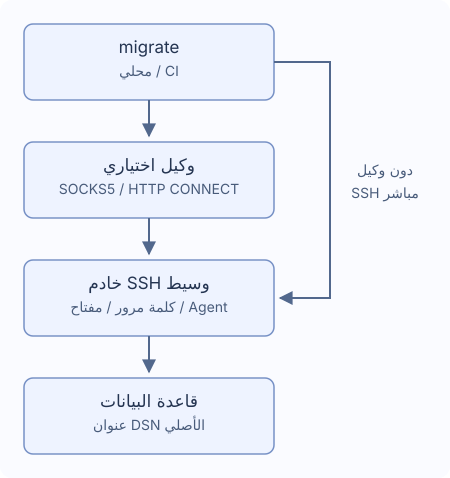

# أنفاق SSH والوكلاء

خادم وسيط واحد، اختياريًا عبر SOCKS5 أو HTTP CONNECT. لا يُقرأ `~/.ssh/config`.



## الاتصال

ولّد عبر `migrate new config --ssh-tunnel --ssh-auth password`. احتفظ بعنوان DB الحقيقي وTLS في DSN، ويجب أن يصل الخادم الوسيط إليه.

```yaml
dialect: postgres
data_source_name: "${DATABASE_DSN}" # احتفظ بعنوان قاعدة البيانات الحقيقي
ssh_tunnel:
  host: "${SSH_HOST}"
  port: 22
  user: "${SSH_USER}"
  auth:
    type: password
    password_env: MIGRATE_SSH_PASSWORD # اسم متغير البيئة
  known_hosts_file: ~/.ssh/known_hosts
```

اضبط `DATABASE_DSN` و`SSH_HOST` و`SSH_USER` و`MIGRATE_SSH_PASSWORD`. تحقق من بصمة المفتاح الأول مع المسؤول قبل حفظه. المفاتيح المعدلة أو الملغاة والملفات غير الصالحة تفشل. حضّر known_hosts موثوقًا في CI؛ لا موافقة آلية للمضيف الجديد.

| النوع | الإعداد |
| --- | --- |
| `password` | اسم متغير في `password_env` |
| `private_key` | `key_file`، و`passphrase_env` اختياري للمفتاح المشفر |
| `agent` | Unix socket ‏`SSH_AUTH_SOCK` |

الحقول السرية أسماء متغيرات، ليست قيمًا أو `${...}`. المتغير الغائب قد يطلب إدخالًا مخفيًا، والفارغ يفشل. Windows يستخدم كلمة مرور أو ملف مفتاح. في CI قدم الأسرار ثم `migrate --non-interactive up`. انظر [callbacks في Go](./go-library).

## الوكيل

ولّد بـ`migrate new config --ssh-tunnel --proxy socks5` أو أضف:

```yaml
ssh_tunnel:
  # احتفظ بإعدادات host وuser وauth وأضف proxy في المستوى نفسه
  proxy:
    type: socks5 # استخدم http لاتصال HTTP CONNECT
    address: "${PROXY_ADDRESS}" # مثال proxy.example:1080 دون مخطط URL
    # أضف الحقلين عند الحاجة للمصادقة
    # username: "${PROXY_USER}"
    # password_env: MIGRATE_PROXY_PASSWORD
```

HTTP CONNECT يستخدم `type: http`. العنوان host:port لا URL. المصادقة تتطلب `username` و`password_env`. HTTP Basic يسبق تشفير SSH، فاستعمل شبكة موثوقة. لا رجوع مباشر عند الفشل، ولا متغيرات وكيل النظام أو وكيل HTTPS أو NTLM/Kerberos أو MFA أو سلاسل وكلاء وخوادم وسيطة.

## المسارات والمهل

يدعم `~` و`~/...`، والمسارات النسبية تبدأ من ملف الإعدادات. الافتراضي `~/.ssh/known_hosts`. النصوص غير السرية تدعم المتغيرات و`port` رقم.

| الحقل | الافتراضي |
| --- | --- |
| `connect_timeout` | `10s` |
| `keepalive_interval` | `15s` |
| `keepalive_timeout` | `5s` |

مدد موجبة؛ لا يدخل انتظار تأكيد المفتاح في مهلة المصافحة. الانقطاع يوقف التنفيذ دون إعادة اتصال أو SQL. افحص البيانات والسجل لأن بعض العمليات قد تكون اكتملت.

PostgreSQL وMySQL وMariaDB وMSSQL وOracle وClickHouse وTiDB وRedshift تدعم هدف TCP واحدًا. لا تعدد مضيفين أو Unix socket أو إعادة توجيه خارجي أو نفق SQLite.

- MSSQL: ‏TCP host/port (1433)، دون اكتشاف المثيل أو failover أو MultiSubnetFailover صريح.
- Oracle: ‏`oracle://` بمضيف واحد ومنفذ، TCP/TCPS؛ دون أوصاف اتصال أو SERVER إضافي أو OOB أو مصادقة خارجية.
- ClickHouse: ‏Native وHTTP(S)، دون DSN `http_proxy` أو `HTTP_PROXY`/`HTTPS_PROXY` لطلبات DB. يُحفظ اسم TLS الأصلي.

لا تفتح version/capabilities/new نفقًا. قد يتصل status/baseline/dry-run لقراءة السجل.
