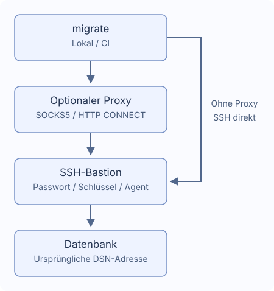

# SSH-Tunnel und Proxys

Ein Bastion-Host, optional über SOCKS5 oder HTTP CONNECT. `~/.ssh/config` wird nicht automatisch gelesen.



## Verbindung

Erzeugen mit `migrate new config --ssh-tunnel --ssh-auth password`. Tatsächliche Datenbankadresse und TLS im DSN erhalten; die Bastion muss die Adresse erreichen.

```yaml
dialect: postgres
data_source_name: "${DATABASE_DSN}" # Tatsächliche Datenbankadresse beibehalten
ssh_tunnel:
  host: "${SSH_HOST}"
  port: 22
  user: "${SSH_USER}"
  auth:
    type: password
    password_env: MIGRATE_SSH_PASSWORD # Name der Umgebungsvariablen
  known_hosts_file: ~/.ssh/known_hosts
```

`DATABASE_DSN`, `SSH_HOST`, `SSH_USER`, `MIGRATE_SSH_PASSWORD` setzen. Den ersten Fingerabdruck mit dem Administrator prüfen und erst dann speichern. Geänderte oder widerrufene Schlüssel sowie ungültige Dateien führen zum Fehler. CI benötigt vorab vertrauenswürdige `known_hosts`; neue Hosts werden nicht automatisch akzeptiert.

## Authentifizierung

| Typ | Felder |
| --- | --- |
| `password` | Variablenname in `password_env` |
| `private_key` | `key_file`, optional `passphrase_env` für verschlüsselte Schlüssel |
| `agent` | Unix-Socket `SSH_AUTH_SOCK` |

Geheimnisfelder enthalten Variablennamen, keine Werte oder `${...}`. Fehlende Variablen können verdeckt abgefragt werden; leere Werte schlagen fehl. Unter Windows Passwort oder Schlüsseldatei wählen. In CI Geheimnisse vorab setzen und `migrate --non-interactive up` verwenden. Siehe [Go-Callbacks](./go-library).

## Proxy

Erzeugen mit `migrate new config --ssh-tunnel --proxy socks5` oder ergänzen:

```yaml
ssh_tunnel:
  # host, user und auth beibehalten; proxy auf derselben Ebene ergänzen
  proxy:
    type: socks5 # Für HTTP CONNECT http verwenden
    address: "${PROXY_ADDRESS}" # Beispiel: proxy.example:1080, ohne URL-Schema
    # Bei Authentifizierung beide Felder setzen
    # username: "${PROXY_USER}"
    # password_env: MIGRATE_PROXY_PASSWORD
```

HTTP CONNECT nutzt `type: http`. Adresse als host:port, nicht URL. Authentifizierung verlangt `username` und `password_env`. HTTP Basic wird vor der SSH-Verschlüsselung übertragen, daher nur vertrauenswürdige Netze verwenden. Kein direkter Rückfall, keine Systemproxyvariablen, HTTPS-Proxys, NTLM/Kerberos, MFA oder mehrstufigen Proxy-/Bastion-Ketten.

## Pfade und Zeitlimits

`~` und `~/...` werden unterstützt; relative Pfade gelten ab der Konfigurationsdatei. Standard: `~/.ssh/known_hosts`. Andere nichtgeheime Zeichenfolgen erlauben Variablen; `port` ist numerisch.

| Einstellung | Standard |
| --- | --- |
| `connect_timeout` | `10s` |
| `keepalive_interval` | `15s` |
| `keepalive_timeout` | `5s` |

Positive Zeitwerte verwenden. Die Fingerabdruckbestätigung verbraucht keine Handshakezeit. Bei Verbindungsabbruch stoppt die Migration ohne Wiederverbindung oder SQL-Wiederholung. Daten und Verlauf prüfen, da Operationen bereits abgeschlossen sein können.

## Datenbanken und Einschränkungen

PostgreSQL, MySQL, MariaDB, MSSQL, Oracle, ClickHouse, TiDB und Redshift unterstützen ein TCP-Ziel. Keine Mehrhost-DSNs, Unix-Sockets, fremden Umleitungen oder SQLite-Tunnel.

- MSSQL: TCP-Host/Port (1433), ohne Instanzsuche, Failover oder explizites MultiSubnetFailover.
- Oracle: ein `oracle://`-Host mit Port, TCP/TCPS; keine Deskriptoren, zusätzlichen SERVER, OOB oder externe Authentifizierung.
- ClickHouse: Native und HTTP(S), kein DSN-`http_proxy` und keine `HTTP_PROXY`/`HTTPS_PROXY` für DB-Anfragen. Ursprünglicher TLS-Name bleibt erhalten.

`version`, `capabilities`, `new` öffnen kein SSH. status, baseline und dry-run können Verlauf lesen und sich verbinden.
