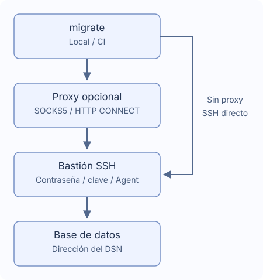

# Túneles SSH y proxies

Usa un bastión único, opcionalmente mediante SOCKS5 o HTTP CONNECT. No se carga `~/.ssh/config`.



## Conexión

Genera con `migrate new config --ssh-tunnel --ssh-auth password`. Conserva en el DSN la dirección real y TLS de la base, accesible desde el bastión.

```yaml
dialect: postgres
data_source_name: "${DATABASE_DSN}" # Conserva la dirección real de la base
ssh_tunnel:
  host: "${SSH_HOST}"
  port: 22
  user: "${SSH_USER}"
  auth:
    type: password
    password_env: MIGRATE_SSH_PASSWORD # Nombre de la variable de entorno
  known_hosts_file: ~/.ssh/known_hosts
```

Define `DATABASE_DSN`, `SSH_HOST`, `SSH_USER`, `MIGRATE_SSH_PASSWORD`. Verifica la huella inicial con el administrador antes de guardarla. Claves modificadas, revocadas o registros inválidos fallan. Prepara `known_hosts` en CI; los hosts nuevos no se aprueban automáticamente.

## Autenticación

| Tipo | Campos |
| --- | --- |
| `password` | Nombre de variable en `password_env` |
| `private_key` | `key_file`, y `passphrase_env` opcional para claves cifradas |
| `agent` | Socket Unix `SSH_AUTH_SOCK` |

Los campos secretos contienen nombres de variables, nunca valores ni `${...}`. Una variable ausente puede solicitarse sin eco; una vacía falla. En Windows usa contraseña o archivo de clave. En CI proporciona los secretos y ejecuta `migrate --non-interactive up`. Consulta los [callbacks Go](./go-library).

## Proxy

Genera con `migrate new config --ssh-tunnel --proxy socks5` o añade:

```yaml
ssh_tunnel:
  # Conserva host, user y auth; añade proxy al mismo nivel
  proxy:
    type: socks5 # Usa http para HTTP CONNECT
    address: "${PROXY_ADDRESS}" # Ejemplo: proxy.example:1080, sin esquema URL
    # Para autenticar, añade ambos campos
    # username: "${PROXY_USER}"
    # password_env: MIGRATE_PROXY_PASSWORD
```

HTTP CONNECT usa `type: http`. La dirección es host:port, no URL. La autenticación requiere `username` y `password_env`. HTTP Basic viaja antes del cifrado SSH; úsalo en redes de confianza. No hay conexión directa alternativa, variables proxy del sistema, proxies HTTPS, NTLM/Kerberos, MFA ni cadenas de proxies o bastiones.

## Rutas y tiempos

Se admiten `~` y `~/...`; rutas relativas desde el archivo de configuración. Por defecto se usa `~/.ssh/known_hosts`. Otras cadenas no secretas aceptan variables; `port` es numérico.

| Ajuste | Predeterminado |
| --- | --- |
| `connect_timeout` | `10s` |
| `keepalive_interval` | `15s` |
| `keepalive_timeout` | `5s` |

Usa duraciones positivas. La confirmación de huella no consume el timeout de negociación. Al desconectar se detiene sin reconexión ni reejecución SQL; verifica datos e historial, pues algunos cambios pueden haber terminado.

## Bases y restricciones

PostgreSQL, MySQL, MariaDB, MSSQL, Oracle, ClickHouse, TiDB y Redshift admiten un destino TCP. No DSN multihost, sockets Unix, redirecciones externas ni túneles SQLite.

- MSSQL: host/puerto TCP (1433), sin descubrimiento de instancia, failover ni MultiSubnetFailover explícito.
- Oracle: URL `oracle://` de un host con puerto, TCP/TCPS; sin descriptores, SERVER adicionales, OOB ni autenticación externa.
- ClickHouse: Native y HTTP(S), sin `http_proxy` en DSN ni `HTTP_PROXY`/`HTTPS_PROXY` para la base. Se conserva el nombre TLS original.

`version`, `capabilities` y `new` no abren SSH. status, baseline y dry-run pueden conectar para leer el historial.
