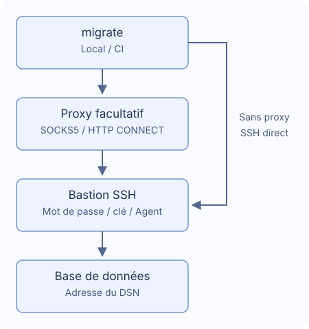

# Tunnels SSH et proxys

Utilisez un seul bastion, éventuellement via SOCKS5 ou HTTP CONNECT. `~/.ssh/config` n’est pas chargé automatiquement.



## Connexion

Générez avec `migrate new config --ssh-tunnel --ssh-auth password`. Conservez dans le DSN l’adresse réelle de la base et son TLS ; le bastion doit pouvoir l’atteindre.

```yaml
dialect: postgres
data_source_name: "${DATABASE_DSN}" # Conserver l’adresse réelle de la base
ssh_tunnel:
  host: "${SSH_HOST}"
  port: 22
  user: "${SSH_USER}"
  auth:
    type: password
    password_env: MIGRATE_SSH_PASSWORD # Nom de la variable d’environnement
  known_hosts_file: ~/.ssh/known_hosts
```

Définissez `DATABASE_DSN`, `SSH_HOST`, `SSH_USER`, `MIGRATE_SSH_PASSWORD`. Vérifiez l’empreinte initiale avec l’administrateur avant de la sauvegarder. Les clés modifiées, révoquées ou les fichiers invalides échouent. En CI, préparez `known_hosts` : les hôtes inconnus ne sont pas approuvés automatiquement.

## Authentification

| Type | Champs |
| --- | --- |
| `password` | `password_env` : nom de variable |
| `private_key` | `key_file`, éventuellement `passphrase_env` pour une clé chiffrée |
| `agent` | Socket Unix `SSH_AUTH_SOCK` |

Les champs secrets contiennent des noms de variables, pas les valeurs ni `${...}`. Une variable absente peut être demandée sans écho ; une valeur vide échoue. Sous Windows, utilisez mot de passe ou fichier de clé. En CI, fournissez les secrets et utilisez `migrate --non-interactive up`. Voir les [callbacks Go](./go-library).

## Proxy

Générez avec `migrate new config --ssh-tunnel --proxy socks5`, ou ajoutez :

```yaml
ssh_tunnel:
  # Conserver host, user, auth et ajouter proxy au même niveau
  proxy:
    type: socks5 # Utiliser http pour HTTP CONNECT
    address: "${PROXY_ADDRESS}" # Exemple : proxy.example:1080, sans schéma URL
    # Pour l’authentification, définir les deux champs
    # username: "${PROXY_USER}"
    # password_env: MIGRATE_PROXY_PASSWORD
```

HTTP CONNECT utilise `type: http`. L’adresse est host:port, sans schéma URL. L’authentification exige `username` et `password_env`. HTTP Basic est envoyé avant le chiffrement SSH, donc uniquement sur un réseau de confiance. Aucun repli direct après échec, ni variables proxy système, proxy HTTPS, NTLM/Kerberos, MFA ou chaînes de proxys/bastions.

## Chemins et délais

`~` et `~/...` sont acceptés. Les chemins relatifs partent du fichier de configuration. Le fichier par défaut est `~/.ssh/known_hosts`. Les autres chaînes non secrètes acceptent les variables ; `port` est numérique.

| Réglage | Défaut |
| --- | --- |
| `connect_timeout` | `10s` |
| `keepalive_interval` | `15s` |
| `keepalive_timeout` | `5s` |

Les durées doivent être positives. La confirmation de clé ne compte pas dans le délai de négociation. Une coupure arrête la migration sans reconnexion ni rejeu SQL ; inspectez données et historique, car certaines opérations peuvent être terminées.

## Bases et restrictions

PostgreSQL, MySQL, MariaDB, MSSQL, Oracle, ClickHouse, TiDB et Redshift : une cible TCP. Pas de DSN multi-hôtes, socket Unix, redirection externe ni tunnel SQLite.

- MSSQL : host/port TCP (1433 par défaut), sans découverte d’instance, failover ou MultiSubnetFailover explicite.
- Oracle : URL `oracle://` à un hôte avec port, TCP/TCPS ; pas de descripteur, SERVER supplémentaire, OOB ou authentification externe.
- ClickHouse : Native et HTTP(S), sans `http_proxy` dans le DSN ni `HTTP_PROXY`/`HTTPS_PROXY` pour les requêtes DB. Le nom TLS d’origine est conservé.

`version`, `capabilities`, `new` n’ouvrent pas SSH. status, baseline et dry-run peuvent se connecter pour lire l’historique.
