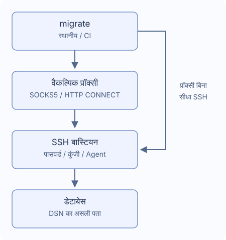

# SSH टनल और प्रॉक्सी

एक बास्टियन, वैकल्पिक SOCKS5 या HTTP CONNECT के साथ। `~/.ssh/config` नहीं पढ़ा जाता।



## कनेक्शन

`migrate new config --ssh-tunnel --ssh-auth password` से बनाएँ। DSN में असली DB पता और TLS रखें; बास्टियन से वह पहुँचना चाहिए।

```yaml
dialect: postgres
data_source_name: "${DATABASE_DSN}" # डेटाबेस का असली पता रखें
ssh_tunnel:
  host: "${SSH_HOST}"
  port: 22
  user: "${SSH_USER}"
  auth:
    type: password
    password_env: MIGRATE_SSH_PASSWORD # एनवायरनमेंट वेरिएबल का नाम
  known_hosts_file: ~/.ssh/known_hosts
```

DATABASE_DSN, SSH_HOST, SSH_USER, MIGRATE_SSH_PASSWORD सेट करें। पहली कुंजी सहेजने से पहले administrator से fingerprint मिलाएँ। बदली/रद्द कुंजी या खराब फ़ाइल विफल है। CI में trusted known_hosts पहले दें; अनजान host खुद स्वीकार नहीं होता।

| प्रकार | फ़ील्ड |
| --- | --- |
| `password` | password_env में वेरिएबल नाम |
| `private_key` | key_file, एन्क्रिप्टेड कुंजी का वैकल्पिक passphrase_env |
| `agent` | Unix socket SSH_AUTH_SOCK |

सीक्रेट फ़ील्ड में नाम दें, मान या ${...} नहीं। अनुपस्थित मान छिपे इनपुट से पूछा जा सकता है, खाली मान विफल है। Windows में पासवर्ड/कुंजी फ़ाइल लें। CI में सीक्रेट देकर `migrate --non-interactive up` चलाएँ। [Go callbacks](./go-library) देखें।

## प्रॉक्सी

`migrate new config --ssh-tunnel --proxy socks5` बनाएँ या जोड़ें:

```yaml
ssh_tunnel:
  # host, user, auth बनाए रखें और उसी स्तर पर proxy जोड़ें
  proxy:
    type: socks5 # HTTP CONNECT के लिए http रखें
    address: "${PROXY_ADDRESS}" # उदाहरण proxy.example:1080, URL स्कीम के बिना
    # प्रमाणीकरण के लिए दोनों फ़ील्ड जोड़ें
    # username: "${PROXY_USER}"
    # password_env: MIGRATE_PROXY_PASSWORD
```

HTTP CONNECT में `type: http`, पता host:port है, URL नहीं। प्रमाणीकरण में username और password_env दोनों दें। HTTP Basic SSH एन्क्रिप्शन से पहले जाता है, केवल विश्वसनीय नेटवर्क में उपयोग करें। असफल होने पर सीधा कनेक्शन, सिस्टम proxy वेरिएबल, HTTPS proxy, NTLM/Kerberos, MFA, बहु proxy/बास्टियन चेन नहीं हैं।

## पथ और समय

`~`, `~/...` समर्थित; सापेक्ष पथ कॉन्फ़िगरेशन फ़ाइल से। डिफ़ॉल्ट `~/.ssh/known_hosts`। गैर-सीक्रेट स्ट्रिंग वेरिएबल स्वीकारती हैं; port संख्या है।

| सेटिंग | डिफ़ॉल्ट |
| --- | --- |
| `connect_timeout` | `10s` |
| `keepalive_interval` | `15s` |
| `keepalive_timeout` | `5s` |

धनात्मक अवधि दें। कुंजी पुष्टि का इंतजार handshake समय में नहीं गिना जाता। disconnect पर बिना reconnect या SQL दोहराए रुकता है। डेटा और इतिहास देखें क्योंकि कुछ ऑपरेशन पूरे हो सकते हैं।

PostgreSQL, MySQL, MariaDB, MSSQL, Oracle, ClickHouse, TiDB, Redshift में एक TCP लक्ष्य है। multihost, Unix socket, बाहरी redirect, SQLite टनल नहीं।

- MSSQL: TCP host/port (1433), instance खोज, failover, स्पष्ट MultiSubnetFailover नहीं।
- Oracle: एक host और port वाला oracle://, TCP/TCPS; descriptors, अतिरिक्त SERVER, OOB, बाहरी प्रमाणीकरण नहीं।
- ClickHouse: Native और HTTP(S); DSN http_proxy या DB के लिए HTTP_PROXY/HTTPS_PROXY नहीं। मूल TLS नाम सुरक्षित है।

version/capabilities/new SSH नहीं खोलते। status/baseline/dry-run इतिहास के लिए जुड़ सकते हैं।
