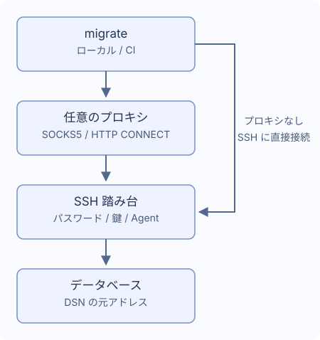

# SSH トンネルとプロキシ

ひとつの踏み台を経由し、必要なら SOCKS5 または HTTP CONNECT プロキシから踏み台へ接続できます。`~/.ssh/config` は読み込みません。



## 接続設定

`migrate new config --ssh-tunnel --ssh-auth password` で生成し、DB の実アドレスと TLS 設定を DSN に残します。踏み台から到達できるアドレスを指定してください。

```yaml
dialect: postgres
data_source_name: "${DATABASE_DSN}" # 実際のデータベースアドレスを指定
ssh_tunnel:
  host: "${SSH_HOST}"
  port: 22
  user: "${SSH_USER}"
  auth:
    type: password
    password_env: MIGRATE_SSH_PASSWORD # 環境変数の名前
  known_hosts_file: ~/.ssh/known_hosts
```

`DATABASE_DSN`、`SSH_HOST`、`SSH_USER`、`MIGRATE_SSH_PASSWORD` を設定します。初回接続は管理者と指紋を照合してから保存します。変更・失効した鍵や壊れた記録はエラーです。CI は未知の鍵を自動承認せず、信頼済みの `known_hosts` を事前に用意します。

## 認証

| `auth.type` | 設定 |
| --- | --- |
| `password` | `password_env` に環境変数名 |
| `private_key` | `key_file`、暗号化鍵は任意の `passphrase_env` |
| `agent` | Unix の `SSH_AUTH_SOCK` を使用 |

`password_env` と `passphrase_env` には秘密の値や `${...}` ではなく変数名を指定します。未設定なら対話入力が可能、空ならエラーです。Windows はパスワードか鍵ファイルを使用します。CI では認証情報を渡して `migrate --non-interactive up` を実行します。[Go のコールバック](./go-library)も参照してください。

## プロキシ

`migrate new config --ssh-tunnel --proxy socks5` で生成できます。既存設定には次の項目を追加します。

```yaml
ssh_tunnel:
  # host、user、auth を残し、同じ階層に proxy を追加
  proxy:
    type: socks5 # HTTP CONNECT は http
    address: "${PROXY_ADDRESS}" # 例: proxy.example:1080。スキームは不要
    # 認証時は両方の項目を指定
    # username: "${PROXY_USER}"
    # password_env: MIGRATE_PROXY_PASSWORD
```

HTTP CONNECT は `type: http` にします。アドレスは URL ではなく host:port です。認証には `username` と `password_env` の両方が必要です。HTTP Basic は SSH 暗号化前に送られるため、信頼するネットワークで使用してください。失敗時の直接接続、システムプロキシ変数、HTTPS プロキシ、NTLM/Kerberos、MFA、プロキシや踏み台の多段接続には対応しません。

## パスと時間制限

`~` と `~/...` に対応し、相対パスは設定ファイル基準です。`known_hosts_file` の既定は `~/.ssh/known_hosts`。その他の通常文字列は環境変数を使用できます。`port` は数値です。

| 設定 | 既定 |
| --- | --- |
| `connect_timeout` | `10s` |
| `keepalive_interval` | `15s` |
| `keepalive_timeout` | `5s` |

正の時間を設定します。指紋確認の待ち時間はハンドシェイクの期限に含みません。切断時は停止し、再接続や SQL の再実行は行いません。DB 側で処理済みの場合もあるためデータと履歴を確認してください。

## 接続できるデータベース

PostgreSQL、MySQL、MariaDB、MSSQL、Oracle、ClickHouse、TiDB、Redshift の単一 TCP 接続先に対応します。複数ホスト、Unix socket、別アドレスへの転送、SQLite のトンネルは不可です。

- MSSQL は TCP host/port（既定 1433）。名前付きインスタンス探索、failover、明示的な MultiSubnetFailover は不可。
- Oracle はポート付きの単一 `oracle://` URL（TCP/TCPS）。接続記述子、追加 SERVER、OOB、外部認証は不可。
- ClickHouse は Native と HTTP(S)。DSN の `http_proxy` は不可で、DB リクエストに `HTTP_PROXY`/`HTTPS_PROXY` を使いません。元の TLS ホスト名を保持します。

`version`、`capabilities`、`new` はトンネルを開きません。`status`、`baseline`、dry-run は履歴を読むため接続する場合があります。
