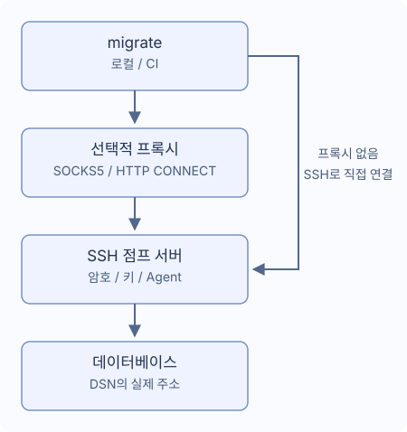

# SSH 터널과 프록시

하나의 점프 서버를 사용하며 SOCKS5 또는 HTTP CONNECT를 거칠 수 있습니다. `~/.ssh/config`는 읽지 않습니다.



## 연결

`migrate new config --ssh-tunnel --ssh-auth password`로 생성합니다. DSN에 DB의 실제 주소와 TLS를 유지하고 점프 서버에서 접근 가능해야 합니다.

```yaml
dialect: postgres
data_source_name: "${DATABASE_DSN}" # 실제 데이터베이스 주소 유지
ssh_tunnel:
  host: "${SSH_HOST}"
  port: 22
  user: "${SSH_USER}"
  auth:
    type: password
    password_env: MIGRATE_SSH_PASSWORD # 환경 변수 이름
  known_hosts_file: ~/.ssh/known_hosts
```

`DATABASE_DSN`, `SSH_HOST`, `SSH_USER`, `MIGRATE_SSH_PASSWORD`를 설정합니다. 첫 연결은 관리자와 지문을 확인한 후 저장하세요. 변경되거나 취소된 키, 잘못된 파일은 실패합니다. CI에는 trusted known_hosts를 미리 준비하며 새 호스트를 자동 승인하지 않습니다.

| 종류 | 필드 |
| --- | --- |
| `password` | 환경 변수 이름 `password_env` |
| `private_key` | `key_file`, 암호화 키의 선택적 `passphrase_env` |
| `agent` | Unix 소켓 `SSH_AUTH_SOCK` |

비밀 필드에는 값이나 `${...}` 대신 변수 이름을 씁니다. 없으면 숨김 입력을 요청할 수 있지만 빈 값이면 실패합니다. Windows는 암호나 키 파일을 사용하세요. CI에서 미리 주입하고 `migrate --non-interactive up`을 실행합니다. [Go 콜백](./go-library)도 참고하세요.

## 프록시

`migrate new config --ssh-tunnel --proxy socks5`로 생성하거나 추가합니다.

```yaml
ssh_tunnel:
  # host, user, auth를 유지하고 같은 수준에 proxy 추가
  proxy:
    type: socks5 # HTTP CONNECT는 http 사용
    address: "${PROXY_ADDRESS}" # 예: proxy.example:1080, URL 스킴 제외
    # 인증이 필요하면 두 필드 모두 설정
    # username: "${PROXY_USER}"
    # password_env: MIGRATE_PROXY_PASSWORD
```

HTTP CONNECT는 `type: http`, 주소는 URL이 아닌 host:port입니다. 인증은 `username`과 `password_env`가 모두 필요합니다. HTTP Basic은 SSH 암호화 이전에 전송하므로 신뢰하는 네트워크에서 사용합니다. 직접 연결 대체, 시스템 프록시 변수, HTTPS 프록시, NTLM/Kerberos, MFA, 다중 프록시/점프 체인은 지원하지 않습니다.

## 경로와 시간

`~`, `~/...`를 지원하며 상대 경로는 설정 파일 기준입니다. 기본 known_hosts는 `~/.ssh/known_hosts`입니다. 일반 문자열은 변수를 지원하고 `port`는 숫자입니다.

| 설정 | 기본 |
| --- | --- |
| `connect_timeout` | `10s` |
| `keepalive_interval` | `15s` |
| `keepalive_timeout` | `5s` |

양의 시간을 사용합니다. 지문 확인 대기는 핸드셰이크 제한에 포함되지 않습니다. 연결이 끊기면 재접속이나 SQL 재실행 없이 멈춥니다. 일부 작업이 완료됐을 수 있으니 데이터와 이력을 확인하세요.

PostgreSQL, MySQL, MariaDB, MSSQL, Oracle, ClickHouse, TiDB, Redshift의 단일 TCP 대상을 지원합니다. 다중 호스트, Unix socket, 외부 주소 리디렉션, SQLite 터널은 지원하지 않습니다.

- MSSQL: TCP host/port(1433), 인스턴스 탐색, failover, 명시적 MultiSubnetFailover 불가.
- Oracle: 포트가 있는 단일 `oracle://`, TCP/TCPS. 연결 설명자, 추가 SERVER, OOB, 외부 인증 불가.
- ClickHouse: Native와 HTTP(S), DSN `http_proxy` 및 DB용 `HTTP_PROXY`/`HTTPS_PROXY` 불가. 원래 TLS 이름 유지.

version/capabilities/new는 SSH를 시작하지 않습니다. status/baseline/dry-run은 이력을 읽으려고 연결할 수 있습니다.
