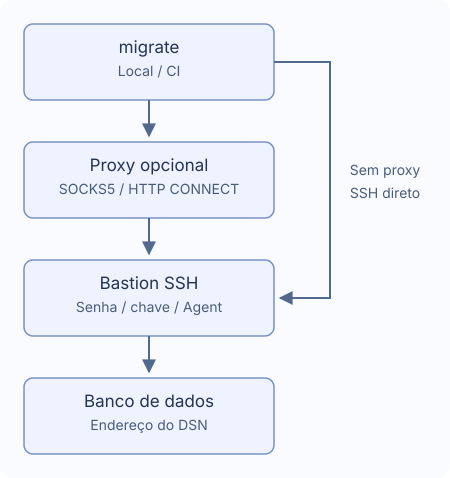

# Túneis SSH e proxies

Um bastion, opcionalmente via SOCKS5 ou HTTP CONNECT. Não lê `~/.ssh/config`.



## Conectar

Gere com `migrate new config --ssh-tunnel --ssh-auth password`. Mantenha endereço real e TLS do banco no DSN, acessíveis pelo bastion.

```yaml
dialect: postgres
data_source_name: "${DATABASE_DSN}" # Mantenha o endereço real do banco
ssh_tunnel:
  host: "${SSH_HOST}"
  port: 22
  user: "${SSH_USER}"
  auth:
    type: password
    password_env: MIGRATE_SSH_PASSWORD # Nome da variável de ambiente
  known_hosts_file: ~/.ssh/known_hosts
```

Defina `DATABASE_DSN`, `SSH_HOST`, `SSH_USER`, `MIGRATE_SSH_PASSWORD`. Confirme a impressão digital com o administrador antes de salvar. Chaves alteradas/revogadas ou registros inválidos falham. CI precisa de `known_hosts` confiável previamente; não aceita hosts novos automaticamente.

| Tipo | Campos |
| --- | --- |
| `password` | Nome de variável em `password_env` |
| `private_key` | `key_file`, `passphrase_env` opcional para chave cifrada |
| `agent` | Socket Unix `SSH_AUTH_SOCK` |

Campos secretos usam nomes de variáveis, nunca valores ou `${...}`. Ausência pode solicitar entrada sem eco; valor vazio falha. No Windows use senha ou arquivo de chave. Na CI injete segredos e execute `migrate --non-interactive up`. Veja [callbacks Go](./go-library).

## Proxy

Gere com `migrate new config --ssh-tunnel --proxy socks5` ou acrescente:

```yaml
ssh_tunnel:
  # Mantenha host, user e auth e adicione proxy no mesmo nível
  proxy:
    type: socks5 # Use http para HTTP CONNECT
    address: "${PROXY_ADDRESS}" # Exemplo: proxy.example:1080, sem esquema URL
    # Para autenticação, adicione os dois campos
    # username: "${PROXY_USER}"
    # password_env: MIGRATE_PROXY_PASSWORD
```

HTTP CONNECT usa `type: http`. Endereço host:port, não URL. Autenticação exige `username` e `password_env`. HTTP Basic ocorre antes da criptografia SSH; use redes confiáveis. Sem retorno à conexão direta, variáveis proxy do sistema, proxy HTTPS, NTLM/Kerberos, MFA ou cadeias de proxies/bastions.

## Caminhos e tempos

Aceita `~` e `~/...`; caminhos relativos partem da configuração. Padrão `~/.ssh/known_hosts`. Outras strings não secretas aceitam variáveis; `port` é número.

| Campo | Padrão |
| --- | --- |
| `connect_timeout` | `10s` |
| `keepalive_interval` | `15s` |
| `keepalive_timeout` | `5s` |

Tempos positivos; a confirmação da chave não conta no handshake. A desconexão interrompe sem reconectar ou repetir SQL. Confira dados e histórico, pois operações podem ter concluído.

PostgreSQL, MySQL, MariaDB, MSSQL, Oracle, ClickHouse, TiDB e Redshift aceitam um destino TCP. Não há multihost, socket Unix, redirecionamento externo ou túnel SQLite.

- MSSQL: TCP host/porta (1433), sem descoberta de instância, failover ou MultiSubnetFailover explícito.
- Oracle: URL `oracle://` de um host com porta, TCP/TCPS; sem descritor, SERVER adicional, OOB ou autenticação externa.
- ClickHouse: Native e HTTP(S), sem `http_proxy` no DSN nem `HTTP_PROXY`/`HTTPS_PROXY` para DB. O nome TLS original é preservado.

version/capabilities/new não abrem SSH. status/baseline/dry-run podem conectar para ler histórico.
