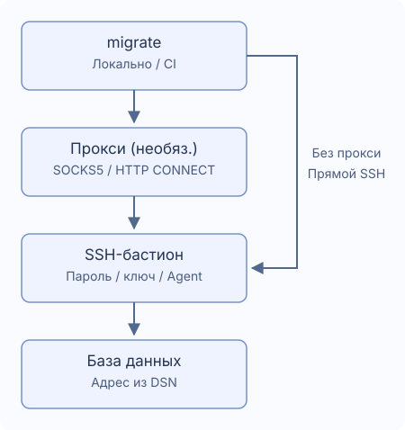

# SSH-туннели и прокси

Один бастион, необязательно через SOCKS5 или HTTP CONNECT. `~/.ssh/config` не загружается.



## Подключение

Создайте `migrate new config --ssh-tunnel --ssh-auth password`. Сохраните в DSN реальный адрес базы и TLS: бастион должен его достигать.

```yaml
dialect: postgres
data_source_name: "${DATABASE_DSN}" # Сохраните настоящий адрес базы
ssh_tunnel:
  host: "${SSH_HOST}"
  port: 22
  user: "${SSH_USER}"
  auth:
    type: password
    password_env: MIGRATE_SSH_PASSWORD # Имя переменной окружения
  known_hosts_file: ~/.ssh/known_hosts
```

Задайте `DATABASE_DSN`, `SSH_HOST`, `SSH_USER`, `MIGRATE_SSH_PASSWORD`. Перед сохранением первой ключевой записи сверьте отпечаток с администратором. Изменённые/отозванные ключи и неверные файлы вызывают ошибку. Для CI заранее подготовьте trusted `known_hosts`; автоматического доверия нет.

| Тип | Настройки |
| --- | --- |
| `password` | Имя переменной в `password_env` |
| `private_key` | `key_file`, необязательный `passphrase_env` для шифрованного ключа |
| `agent` | Unix socket `SSH_AUTH_SOCK` |

Секретные поля содержат имена, не значения или `${...}`. Отсутствующее значение можно ввести без эха, пустое вызывает ошибку. Windows использует пароль или файл ключа. CI: секреты заранее, затем `migrate --non-interactive up`. См. [callbacks Go](./go-library).

## Прокси

Генерация: `migrate new config --ssh-tunnel --proxy socks5`, либо добавьте:

```yaml
ssh_tunnel:
  # Сохраните host, user, auth и добавьте proxy на том же уровне
  proxy:
    type: socks5 # Для HTTP CONNECT укажите http
    address: "${PROXY_ADDRESS}" # Например proxy.example:1080, без схемы URL
    # Для аутентификации задайте оба поля
    # username: "${PROXY_USER}"
    # password_env: MIGRATE_PROXY_PASSWORD
```

HTTP CONNECT: `type: http`, адрес host:port, не URL. Аутентификация требует `username` и `password_env`. HTTP Basic идёт до шифрования SSH — только в доверенной сети. Нет прямого обхода при сбое, системных proxy-переменных, HTTPS-прокси, NTLM/Kerberos, MFA и цепочек прокси/бастионов.

## Пути и время

`~`, `~/...` поддерживаются, относительные пути — от файла настроек. По умолчанию `~/.ssh/known_hosts`. Прочие несекретные строки допускают переменные; `port` — число.

| Поле | По умолчанию |
| --- | --- |
| `connect_timeout` | `10s` |
| `keepalive_interval` | `15s` |
| `keepalive_timeout` | `5s` |

Длительности положительные; подтверждение ключа не расходует handshake timeout. При разрыве выполнение прекращается без переподключения или повтора SQL. Проверьте данные и историю: часть операций могла завершиться.

PostgreSQL, MySQL, MariaDB, MSSQL, Oracle, ClickHouse, TiDB, Redshift: одна TCP-цель. Нет multihost, Unix socket, внешних перенаправлений, туннелей SQLite.

- MSSQL: host/port TCP (1433), без поиска именованных экземпляров, failover, явного MultiSubnetFailover.
- Oracle: однохостовый `oracle://` с портом, TCP/TCPS; без дескрипторов, дополнительных SERVER, OOB, внешней аутентификации.
- ClickHouse: Native и HTTP(S), без DSN `http_proxy` и переменных `HTTP_PROXY`/`HTTPS_PROXY` для DB; исходное имя TLS сохраняется.

version/capabilities/new не открывают SSH. status/baseline/dry-run могут подключаться для истории.
