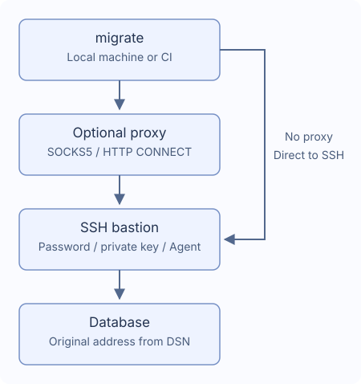

# SSH tunnels and proxies

Connect through one SSH bastion, optionally reached through one SOCKS5 or HTTP
CONNECT proxy. Configure the bastion in migrate without starting SSH port forwarding yourself.
Settings from `~/.ssh/config` are not loaded automatically.



## Configure the route

Start with `migrate new config --ssh-tunnel --ssh-auth password`, then fill in these fields.

Keep the original database address and TLS settings in `DATABASE_DSN`. The bastion
must be able to reach that database address. Add this to your project configuration:

```yaml
dialect: postgres
data_source_name: "${DATABASE_DSN}" # Keep the actual database address
ssh_tunnel:
  host: "${SSH_HOST}"
  port: 22
  user: "${SSH_USER}"
  auth:
    type: password
    password_env: MIGRATE_SSH_PASSWORD # Environment variable name
  known_hosts_file: ~/.ssh/known_hosts
```

Set `DATABASE_DSN`, `SSH_HOST`, `SSH_USER` and `MIGRATE_SSH_PASSWORD` before running commands.

On the first connection to an unknown bastion, the CLI shows its address and host-key fingerprint.
Verify the fingerprint with your administrator, then choose “Trust and save”. Later connections
check the saved record. Changed or revoked keys and invalid records cause the command to fail;
verify and fix the records before continuing. CI never trusts unknown hosts automatically;
prepare a trusted `known_hosts` file before running migrations.

## Choose authentication

| `auth.type` | Fields | Behavior |
| --- | --- | --- |
| `password` | `password_env` | Read the password from the named environment variable |
| `private_key` | `key_file`, optional `passphrase_env` | Read a local key; use the named variable for an encrypted key's passphrase |
| `agent` | No password/key fields | Use the Unix `SSH_AUTH_SOCK` socket |

Use environment variable names such as `MIGRATE_SSH_PASSWORD` for `password_env` and
`passphrase_env`. migrate reads their values at runtime; do not enter passwords or `${...}`
templates in these fields. If a variable is unset, interactive CLI mode can prompt without
echoing your input. Empty values cause an error. On Windows, use password or key-file authentication.

In CI, supply credentials before running `migrate --non-interactive up`; missing credentials
cause the command to fail. For credential prompts and host trust in Go applications, see [Use from Go](./go-library).

## Add an optional proxy

Generate settings with `migrate new config --ssh-tunnel --proxy socks5`,
or add `proxy` under your existing `ssh_tunnel` settings:

```yaml
ssh_tunnel:
  # Keep host, user, auth and other SSH settings above, and add proxy alongside them
  proxy:
    type: socks5 # Use http for HTTP CONNECT
    address: "${PROXY_ADDRESS}" # For example proxy.example:1080, without a URL scheme
    # If authentication is required, add both username and password_env
    # username: "${PROXY_USER}"
    # password_env: MIGRATE_PROXY_PASSWORD
```

Use `type: http` for HTTP CONNECT. The address is host:port, not a URL.
Optional authentication requires both `username` and `password_env`. SOCKS5 supports
username/password and HTTP CONNECT supports Basic. HTTP proxy authentication occurs
before SSH encryption and has no TLS protection; use it only on trusted networks.

Proxy failure does not fall back to a direct connection. System proxy variables,
HTTPS proxy endpoints, NTLM/Kerberos, MFA, proxy chains and SSH jumps are unsupported.

## Paths and timeouts

SSH file paths accept `~` and `~/...`; relative paths resolve from the migration
config file directory. The known-hosts default is `~/.ssh/known_hosts`.
Other nonsecret string settings accept environment templates; `port` is a number, such as `22`.

| Setting | Default |
| --- | --- |
| `connect_timeout` | `10s` |
| `keepalive_interval` | `15s` |
| `keepalive_timeout` | `5s` |

Use positive durations such as `10s` or `5m`. Time spent confirming a host key does not
count toward the handshake timeout. If the connection drops, migration stops without
automatically reconnecting or replaying SQL. Inspect data and history before recovery,
because the database may already have completed some changes.

## Supported database routes

PostgreSQL, MySQL, MariaDB, MSSQL, Oracle, ClickHouse, TiDB and Redshift support a
single TCP target. Multi-host DSNs, Unix sockets, foreign-endpoint redirects and
SQLite tunnel settings fail explicitly.

- MSSQL requires TCP host/port (default 1433), without named-instance discovery,
  failover or explicit MultiSubnetFailover.
- Oracle requires a single-host `oracle://` URL with a port, using TCP/TCPS;
  descriptors, extra SERVER entries, OOB and external auth are unsupported.
- ClickHouse supports Native and HTTP(S). Database `http_proxy` options are rejected;
  `HTTP_PROXY`/`HTTPS_PROXY` are disabled for database requests. Preserve the database
  TLS identity in the original DSN.

`version`, `capabilities` and `new` do not start SSH. `status`, `baseline` and
dry-run may connect to read history.
