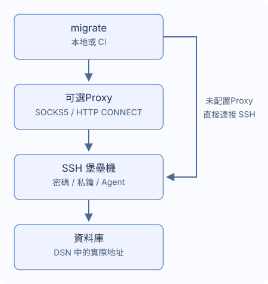

# SSH 隧道與Proxy

通過單台 SSH 堡壘機連接資料庫，也可先經一個 SOCKS5 或 HTTP CONNECT Proxy連接堡壘機。
在 migrate 設定檔案中填寫堡壘機信息，無須手動啓動 SSH 端口轉發；`~/.ssh/config` 中的設置不會自動生效。



## 設定連接路徑

可以先用 `migrate new config --ssh-tunnel --ssh-auth password` 生成設定，再填寫以下字段。

`DATABASE_DSN` 保留原始資料庫地址與 TLS 設置，堡壘機需要能訪問該地址。
在項目設定中添加：

```yaml
dialect: postgres
data_source_name: "${DATABASE_DSN}" # 保留資料庫的實際地址
ssh_tunnel:
  host: "${SSH_HOST}"
  port: 22
  user: "${SSH_USER}"
  auth:
    type: password
    password_env: MIGRATE_SSH_PASSWORD # 填環境變數名
  known_hosts_file: ~/.ssh/known_hosts
```

運行前設置 `DATABASE_DSN`、`SSH_HOST`、`SSH_USER` 和 `MIGRATE_SSH_PASSWORD`。

首次連接陌生堡壘機時，CLI 會顯示 SSH 地址和主機密鑰指紋。
與管理員核對指紋後選擇“信任並保存”，後續連接會使用保存的記錄校驗主機。
主機密鑰發生變化、被撤銷或記錄檔案無效時，命令會失敗，需要先覈實並修正記錄。
CI 不會自動信任新主機，應提前準備可信的 `known_hosts` 檔案。

## 選擇認證方式

| `auth.type` | 字段 | 行為 |
| --- | --- | --- |
| `password` | `password_env` | 從指定環境變數讀取密碼 |
| `private_key` | `key_file`，可選 `passphrase_env` | 讀取本地私鑰；加密私鑰的口令來自指定變數 |
| `agent` | 不設置密碼或私鑰字段 | 使用 Unix `SSH_AUTH_SOCK` socket |

`password_env`、`passphrase_env` 填寫變數名，例如 `MIGRATE_SSH_PASSWORD`。
運行時會讀取該變數的值，不要在這些字段中填寫密碼或 `${...}`。
變數未設置時，交互式 CLI 可以提示輸入且不顯示輸入內容；變數為空時會報錯。
Windows 使用者請選擇密碼或私鑰檔案認證。

CI 中提前提供憑據，再運行 `migrate --non-interactive up`；缺少憑據時命令會直接失敗。
Go 應用中的憑據輸入與主機信任回調見[在 Go 中使用](./go-library)。

## 添加可選Proxy

可以用 `migrate new config --ssh-tunnel --proxy socks5` 生成設定，
或在已有的 `ssh_tunnel` 下添加 `proxy`：

```yaml
ssh_tunnel:
  # 保留上文的 host、user、auth 等設置，在同一級添加Proxy
  proxy:
    type: socks5 # HTTP CONNECT Proxy改為 http
    address: "${PROXY_ADDRESS}" # 例如 proxy.example:1080，不帶協議前綴
    # 需要Proxy認證時，同時添加 username 和 password_env
    # username: "${PROXY_USER}"
    # password_env: MIGRATE_PROXY_PASSWORD
```

HTTP CONNECT 使用 `type: http`；address 是 host:port，不是 URL。
可選認證要求同時設定 `username` 和 `password_env`。SOCKS5 支持使用者名密碼，
HTTP CONNECT 支持 Basic。HTTP Proxy認證發生在 SSH 加密之前，沒有 TLS 保護，
只應在可信網絡使用。

Proxy失敗不會回退直連。不支持系統Proxy變數、HTTPS Proxy端點、NTLM/Kerberos、MFA、
Proxy鏈或 SSH 跳板鏈。

## 路徑與超時

SSH 檔案路徑支持 `~` 和 `~/...`，相對路徑從遷移設定檔案所在目錄解析。
默認主機記錄檔案為 `~/.ssh/known_hosts`。其他非敏感字符串支持環境模板，`port` 填寫數字，例如 `22`。

| 設置 | 默認值 |
| --- | --- |
| `connect_timeout` | `10s` |
| `keepalive_interval` | `15s` |
| `keepalive_timeout` | `5s` |

超時使用 `10s`、`5m` 這樣的正數時長。等待使用者確認主機指紋的時間不計入握手超時。
傳輸中斷時，遷移會停止，不會自動重連或重新執行 SQL。
資料庫可能已完成部分變更，恢復前先檢查資料和歷史。

## 資料庫連接支持

PostgreSQL、MySQL、MariaDB、MSSQL、Oracle、ClickHouse、TiDB 與 Redshift 支持單個 TCP
目標。多主機 DSN、Unix socket、跳轉到其他地址以及 SQLite 隧道設定會明確失敗。

- MSSQL 要求 TCP host/port（默認 1433），不支持命名實例發現、failover 或顯式 MultiSubnetFailover。
- Oracle 要求帶端口的單主機 `oracle://` URL，支持 TCP/TCPS；不支持描述符、額外 SERVER、OOB 或外部認證。
- ClickHouse 支持 Native 與 HTTP(S)，拒絕資料庫 `http_proxy`，資料庫請求禁用
  `HTTP_PROXY`/`HTTPS_PROXY`，原 DSN 中的 TLS 身份保持不變。

`version`、`capabilities`、`new` 不啓動 SSH；`status`、`baseline` 和 dry-run 可能為讀取歷史連接資料庫。
