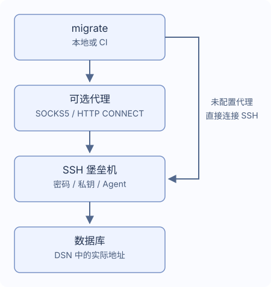

# SSH 隧道与代理

通过单台 SSH 堡垒机连接数据库，也可先经一个 SOCKS5 或 HTTP CONNECT 代理连接堡垒机。
在 migrate 配置文件中填写堡垒机信息，无须手动启动 SSH 端口转发；`~/.ssh/config` 中的设置不会自动生效。



## 配置连接路径

可以先用 `migrate new config --ssh-tunnel --ssh-auth password` 生成配置，再填写以下字段。

`DATABASE_DSN` 保留原始数据库地址与 TLS 设置，堡垒机需要能访问该地址。
在项目配置中添加：

```yaml
dialect: postgres
data_source_name: "${DATABASE_DSN}" # 保留数据库的实际地址
ssh_tunnel:
  host: "${SSH_HOST}"
  port: 22
  user: "${SSH_USER}"
  auth:
    type: password
    password_env: MIGRATE_SSH_PASSWORD # 填环境变量名
  known_hosts_file: ~/.ssh/known_hosts
```

运行前设置 `DATABASE_DSN`、`SSH_HOST`、`SSH_USER` 和 `MIGRATE_SSH_PASSWORD`。

首次连接陌生堡垒机时，CLI 会显示 SSH 地址和主机密钥指纹。
与管理员核对指纹后选择“信任并保存”，后续连接会使用保存的记录校验主机。
主机密钥发生变化、被撤销或记录文件无效时，命令会失败，需要先核实并修正记录。
CI 不会自动信任新主机，应提前准备可信的 `known_hosts` 文件。

## 选择认证方式

| `auth.type` | 字段 | 行为 |
| --- | --- | --- |
| `password` | `password_env` | 从指定环境变量读取密码 |
| `private_key` | `key_file`，可选 `passphrase_env` | 读取本地私钥；加密私钥的口令来自指定变量 |
| `agent` | 不设置密码或私钥字段 | 使用 Unix `SSH_AUTH_SOCK` socket |

`password_env`、`passphrase_env` 填写变量名，例如 `MIGRATE_SSH_PASSWORD`。
运行时会读取该变量的值，不要在这些字段中填写密码或 `${...}`。
变量未设置时，交互式 CLI 可以提示输入且不显示输入内容；变量为空时会报错。
Windows 用户请选择密码或私钥文件认证。

CI 中提前提供凭据，再运行 `migrate --non-interactive up`；缺少凭据时命令会直接失败。
Go 应用中的凭据输入与主机信任回调见[在 Go 中使用](./go-library)。

## 添加可选代理

可以用 `migrate new config --ssh-tunnel --proxy socks5` 生成配置，
或在已有的 `ssh_tunnel` 下添加 `proxy`：

```yaml
ssh_tunnel:
  # 保留上文的 host、user、auth 等设置，在同一级添加代理
  proxy:
    type: socks5 # HTTP CONNECT 代理改为 http
    address: "${PROXY_ADDRESS}" # 例如 proxy.example:1080，不带协议前缀
    # 需要代理认证时，同时添加 username 和 password_env
    # username: "${PROXY_USER}"
    # password_env: MIGRATE_PROXY_PASSWORD
```

HTTP CONNECT 使用 `type: http`；address 是 host:port，不是 URL。
可选认证要求同时配置 `username` 和 `password_env`。SOCKS5 支持用户名密码，
HTTP CONNECT 支持 Basic。HTTP 代理认证发生在 SSH 加密之前，没有 TLS 保护，
只应在可信网络使用。

代理失败不会回退直连。不支持系统代理变量、HTTPS 代理端点、NTLM/Kerberos、MFA、
代理链或 SSH 跳板链。

## 路径与超时

SSH 文件路径支持 `~` 和 `~/...`，相对路径从迁移配置文件所在目录解析。
默认主机记录文件为 `~/.ssh/known_hosts`。其他非敏感字符串支持环境模板，`port` 填写数字，例如 `22`。

| 设置 | 默认值 |
| --- | --- |
| `connect_timeout` | `10s` |
| `keepalive_interval` | `15s` |
| `keepalive_timeout` | `5s` |

超时使用 `10s`、`5m` 这样的正数时长。等待用户确认主机指纹的时间不计入握手超时。
传输中断时，迁移会停止，不会自动重连或重新执行 SQL。
数据库可能已完成部分变更，恢复前先检查数据和历史。

## 数据库连接支持

PostgreSQL、MySQL、MariaDB、MSSQL、Oracle、ClickHouse、TiDB 与 Redshift 支持单个 TCP
目标。多主机 DSN、Unix socket、跳转到其他地址以及 SQLite 隧道配置会明确失败。

- MSSQL 要求 TCP host/port（默认 1433），不支持命名实例发现、failover 或显式 MultiSubnetFailover。
- Oracle 要求带端口的单主机 `oracle://` URL，支持 TCP/TCPS；不支持描述符、额外 SERVER、OOB 或外部认证。
- ClickHouse 支持 Native 与 HTTP(S)，拒绝数据库 `http_proxy`，数据库请求禁用
  `HTTP_PROXY`/`HTTPS_PROXY`，原 DSN 中的 TLS 身份保持不变。

`version`、`capabilities`、`new` 不启动 SSH；`status`、`baseline` 和 dry-run 可能为读取历史连接数据库。
